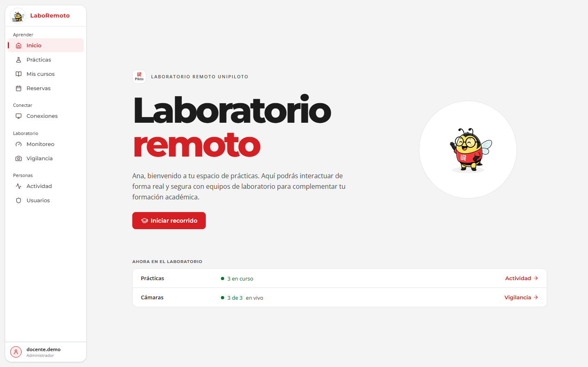
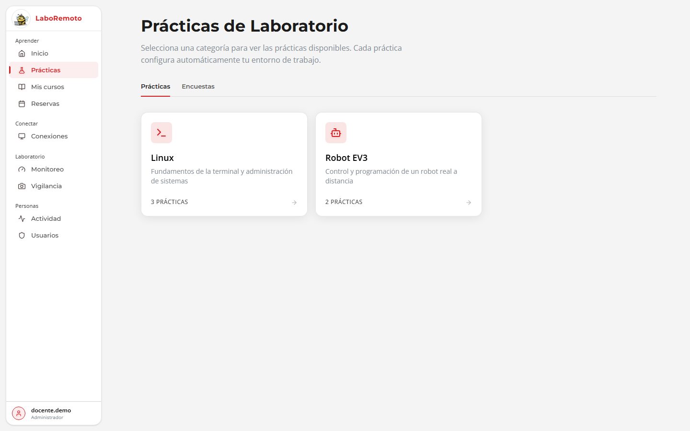
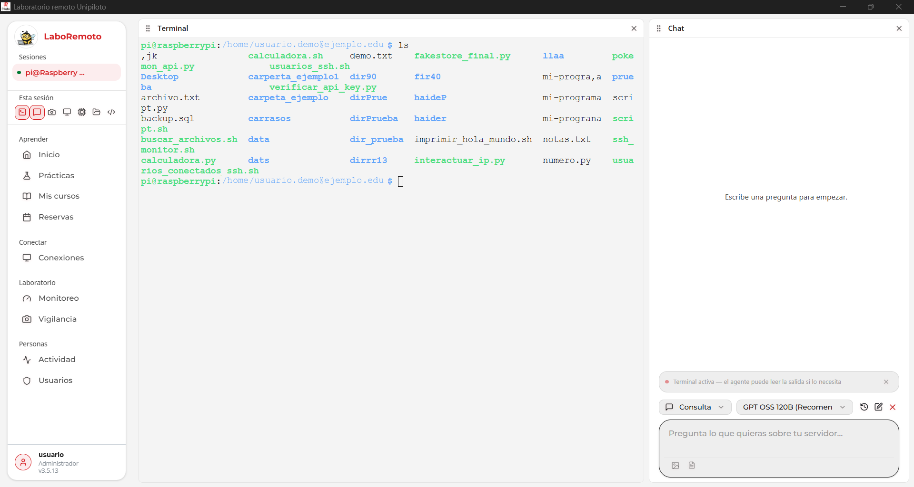
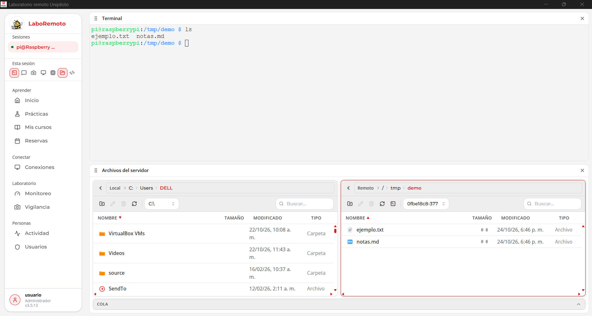
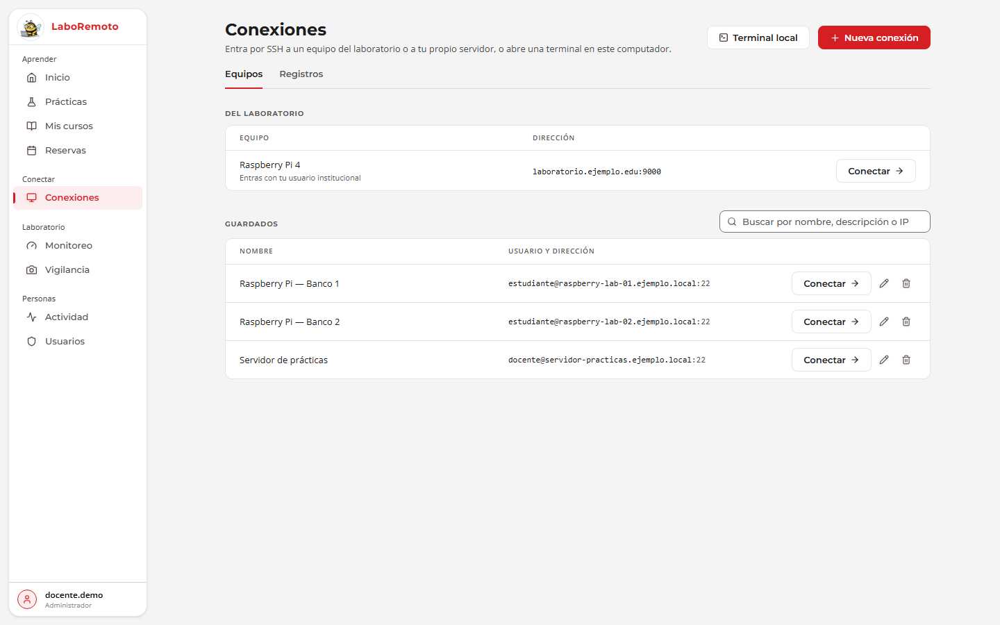
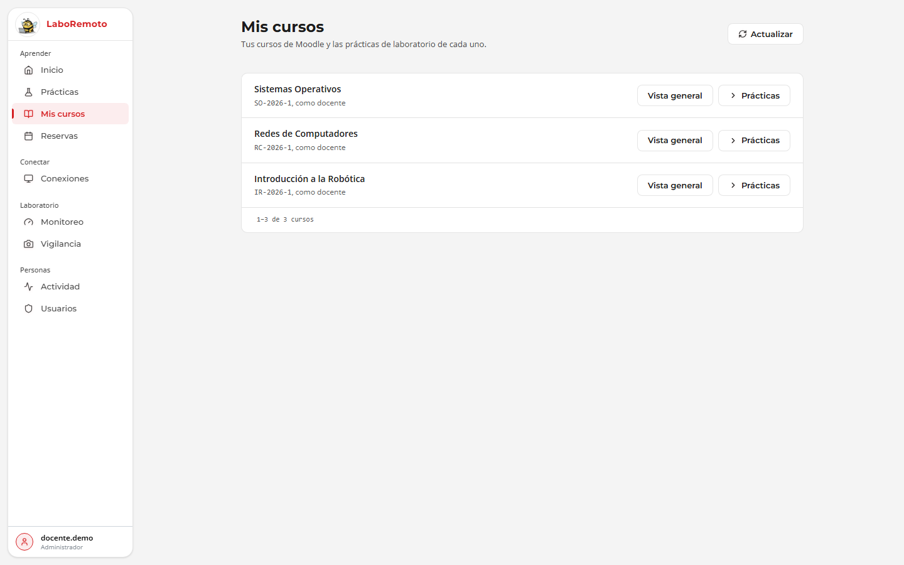
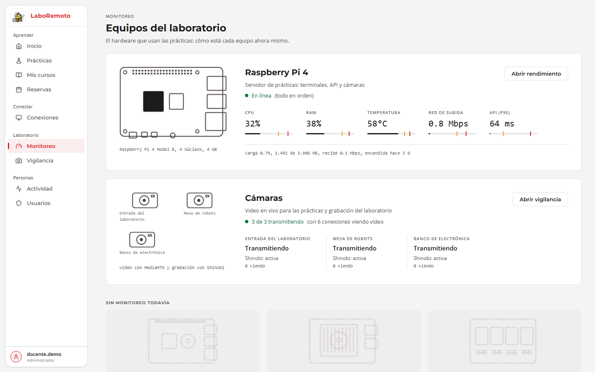
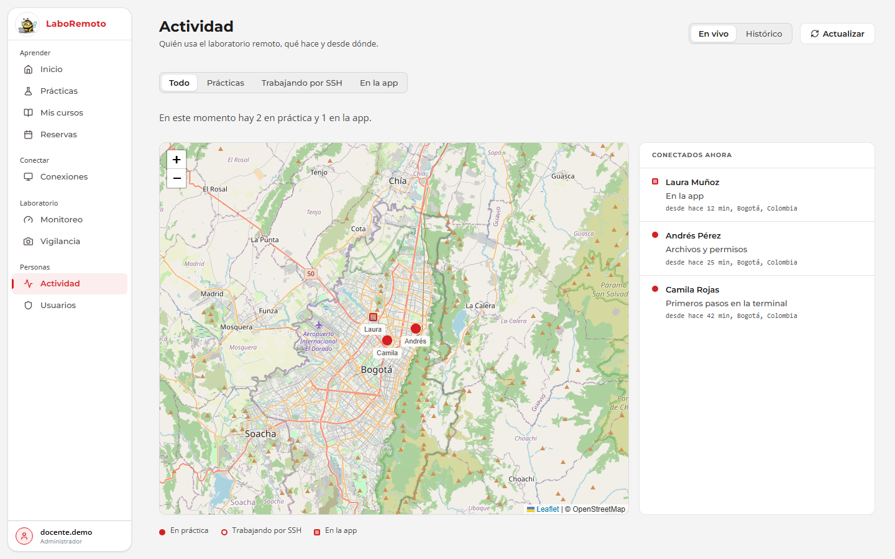
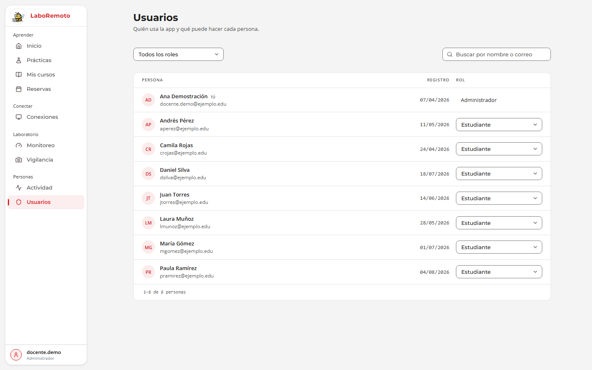

# LaboRemoto

Aplicación de escritorio para trabajar a distancia con los equipos del laboratorio de la Universidad Piloto de Colombia (Raspberry Pi, robots EV3, cámaras). Está hecha con **Tauri 2**: el backend en Rust y la interfaz en React + TypeScript.

## Qué hace

- **Se conecta por SSH a los equipos** y abre, en una sola ventana, una terminal, un gestor de archivos (SFTP), un escritorio gráfico remoto, un chat con IA y paneles de pines y de comandos guardados.
- **Guía prácticas de laboratorio** (Linux y robot EV3): pasos, validación automática, insignias y encuesta final. Los resultados se envían a Moodle.
- **Muestra el laboratorio**: cámaras en vivo con control PTZ y el estado de los equipos.
- **Da herramientas al personal**: actividad en vivo, cursos de Moodle, usuarios y roles.

Cada persona ve solo lo que le corresponde según su rol (`estudiante`, `docente`, `semillerista`, `laboratorista`, `coordinador_laboratorio`, `jefe_laboratorio`, `admin_lab`).

## Cómo funciona

```
Persona ──► Aplicación de escritorio (Tauri)
            │
            ├─ Inicio de sesión ............ Keycloak (OAuth 2.1 + PKCE)
            ├─ Sesiones SSH ................ equipos del laboratorio (terminal, archivos, escritorio)
            ├─ Prácticas y validación ...... API de la Raspberry Pi, por un túnel SSH
            └─ Cámaras, sesiones, Moodle ... brokers HTTP del laboratorio (carpeta infra/)
```

1. La persona inicia sesión con su cuenta institucional. El token de acceso solo lo ve el backend de Rust, nunca la interfaz.
2. Desde **Conexiones** abre una sesión SSH a un equipo. Cada sesión es un mosaico de herramientas (terminal, chat, cámara, escritorio, pines, archivos, comandos) que se reacomodan arrastrando.
3. Las **prácticas** se leen y validan en una API que corre en una Raspberry Pi; la app llega a ella por un túnel SSH. Al terminar, el resultado va a Moodle a través de un broker.
4. Las **cámaras**, el registro de sesiones y Moodle pasan por brokers HTTP desplegados en la red del laboratorio.

## Qué hay en el repositorio

| Carpeta | Contenido |
|---|---|
| [`Cliente-Rust/`](./Cliente-Rust) | La aplicación: `backend/` (Rust), `frontend/` (React), `scripts/` y `tools/`. |
| [`infra/`](./infra) | Servicios del laboratorio: brokers de cámaras, sesiones y Moodle, agente de conexiones, vigilante de Shinobi y contenido de las prácticas. |
| [`docs/`](./docs) | Notas de infraestructura y capturas de pantalla. |
| [`.github/workflows/`](./.github/workflows) | CI de cada PR, borrado de ramas fusionadas y publicación de versiones. |
| [`AGENTS.md`](./AGENTS.md) · [`CLAUDE.md`](./CLAUDE.md) | Contexto para asistentes de código: estructura, comandos y reglas. |

## Arrancar en desarrollo

Requisitos: Rust estable, Node.js 20 y las [dependencias de sistema de Tauri 2](https://v2.tauri.app/start/prerequisites/).

```bash
cd Cliente-Rust
npm run install:all          # dependencias de la raíz y del frontend
cp .env.example .env         # completa los valores
npm run dev                  # lanza la app en modo desarrollo (cargo tauri dev)
```

`npm run dev` usa un script de PowerShell. En otros sistemas, lanza por separado `npm run dev:frontend` y `npm run dev:backend`.

Antes de abrir un PR:

```bash
cd Cliente-Rust
node scripts/check-comandos.mjs                       # comandos de Tauri vs. frontend
cd frontend && npx tsc --noEmit && npx vitest run     # tipos y pruebas del frontend
cd ../backend && cargo check --all-targets && cargo test --lib
```

El CI repite estas comprobaciones en cada PR hacia `Desarrollo`, `Produccion` o `Pruebas(QA)`.

## Documentación

- [`Cliente-Rust/README.md`](./Cliente-Rust/README.md): arquitectura, interfaz, módulos del backend y del frontend, configuración y desarrollo.
- [`infra/broker-gateway/README.md`](./infra/broker-gateway/README.md): índice de los brokers.
- [`Cliente-Rust/CONFIGURACION-ALUMNOS.md`](./Cliente-Rust/CONFIGURACION-ALUMNOS.md): dónde dejar el `.env` en la aplicación instalada.
- [`AGENTS.md`](./AGENTS.md): reglas de trabajo del repositorio.

## Capturas

| | |
|---|---|
| **Inicio** | **Prácticas** |
|  |  |
| **Sesión: terminal y chat** | **Sesión: terminal y archivos** |
|  |  |
| **Conexiones** | **Mis cursos** |
|  |  |
| **Monitoreo** | **Actividad** |
|  |  |
| **Usuarios** | |
|  | |
