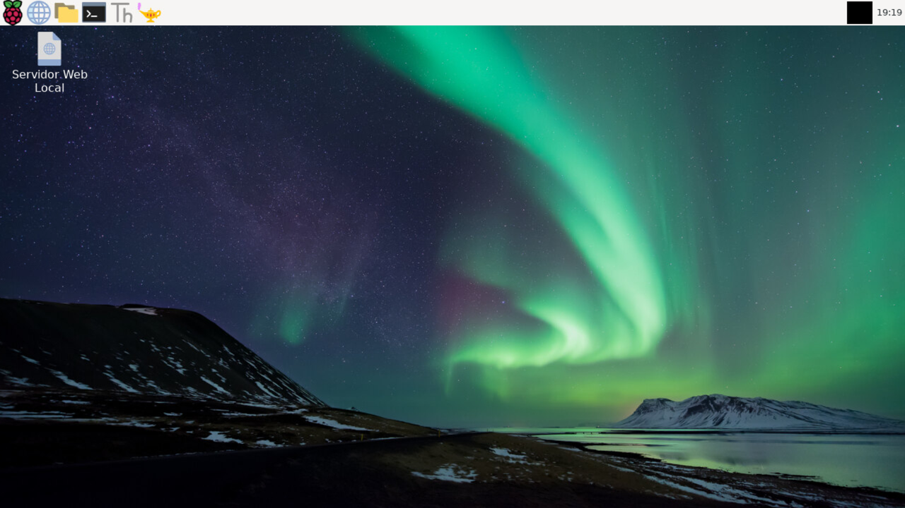

# LaboRemoto

Aplicación de escritorio para trabajar a distancia con los equipos del laboratorio de la Universidad Piloto de Colombia (Raspberry Pi, robots EV3, cámaras). Está hecha con **Tauri 2**: el backend en Rust y la interfaz en React + TypeScript.

## Qué hace

- **Se conecta por SSH a los equipos** y abre, en una sola ventana, una terminal, un gestor de archivos (SFTP), un escritorio gráfico remoto, un chat con IA y paneles de pines y de comandos guardados.
- **Guía prácticas de laboratorio** (Linux y robot EV3): pasos, validación automática, insignias y encuesta final. Los resultados se envían a Moodle.
- **Muestra el laboratorio**: cámaras en vivo con control PTZ y el estado de los equipos.
- **Da herramientas al personal**: actividad en vivo, cursos de Moodle, usuarios y roles.

Cada persona ve solo lo que le corresponde según su rol (`estudiante`, `docente`, `semillerista`, `laboratorista`, `coordinador_laboratorio`, `jefe_laboratorio`, `admin_lab`).

## Cómo funciona

```
Persona ──► Aplicación de escritorio (Tauri)
            │
            ├─ Inicio de sesión ............ Keycloak (OAuth 2.1 + PKCE)
            ├─ Sesiones SSH ................ equipos del laboratorio (terminal, archivos, escritorio)
            ├─ Prácticas y validación ...... API de la Raspberry Pi, por un túnel SSH
            └─ Cámaras, sesiones, Moodle ... brokers HTTP del laboratorio (carpeta infra/)
```

1. La persona inicia sesión con su cuenta institucional. El token de acceso solo lo ve el backend de Rust, nunca la interfaz.
2. Desde **Conexiones** abre una sesión SSH a un equipo. Cada sesión es un mosaico de herramientas (terminal, chat, cámara, escritorio, pines, archivos, comandos) que se reacomodan arrastrando.
3. Las **prácticas** se leen y validan en una API que corre en una Raspberry Pi; la app llega a ella por un túnel SSH. Al terminar, el resultado va a Moodle a través de un broker.
4. Las **cámaras**, el registro de sesiones y Moodle pasan por brokers HTTP desplegados en la red del laboratorio.

## Qué hay en el repositorio

| Carpeta | Contenido |
|---|---|
| [`Cliente-Rust/`](./Cliente-Rust) | La aplicación: `backend/` (Rust), `frontend/` (React), `scripts/` y `tools/`. |
| [`infra/`](./infra) | Servicios del laboratorio: brokers de cámaras, sesiones y Moodle, agente de conexiones, vigilante de Shinobi y contenido de las prácticas. |
| [`docs/`](./docs) | Notas de infraestructura y capturas de pantalla. |
| [`.github/workflows/`](./.github/workflows) | CI de cada PR, borrado de ramas fusionadas y publicación de versiones. |
| [`AGENTS.md`](./AGENTS.md) · [`CLAUDE.md`](./CLAUDE.md) | Contexto para asistentes de código: estructura, comandos y reglas. |

## Arrancar en desarrollo

Requisitos: Rust estable, Node.js 20 y las [dependencias de sistema de Tauri 2](https://v2.tauri.app/start/prerequisites/).

```bash
cd Cliente-Rust
npm run install:all          # dependencias de la raíz y del frontend
cp .env.example .env         # completa los valores
npm run dev                  # lanza la app en modo desarrollo (cargo tauri dev)
```

`npm run dev` usa un script de PowerShell. En otros sistemas, lanza por separado `npm run dev:frontend` y `npm run dev:backend`.

Antes de abrir un PR:

```bash
cd Cliente-Rust
node scripts/check-comandos.mjs                       # comandos de Tauri vs. frontend
cd frontend && npx tsc --noEmit && npx vitest run     # tipos y pruebas del frontend
cd ../backend && cargo check --all-targets && cargo test --lib
```

El CI repite estas comprobaciones en cada PR hacia `Desarrollo`, `Produccion` o `Pruebas(QA)`.

## Documentación

- [`Cliente-Rust/README.md`](./Cliente-Rust/README.md): arquitectura, interfaz, módulos del backend y del frontend, configuración y desarrollo.
- [`infra/broker-gateway/README.md`](./infra/broker-gateway/README.md): índice de los brokers.
- [`Cliente-Rust/CONFIGURACION-ALUMNOS.md`](./Cliente-Rust/CONFIGURACION-ALUMNOS.md): dónde dejar el `.env` en la aplicación instalada.
- [`AGENTS.md`](./AGENTS.md): reglas de trabajo del repositorio.

## Capturas

### Inicio


La portada. A la izquierda está la barra lateral, con las páginas agrupadas en **Aprender**, **Conectar**, **Laboratorio** y **Personas** (cada persona ve solo las de su rol), y abajo su usuario y rol. **Iniciar recorrido** lanza un tutorial guiado. «Ahora en el laboratorio» resume en vivo cuántas prácticas hay en curso y cuántas cámaras están transmitiendo, con un enlace a **Actividad** y a **Vigilancia**.

### Prácticas


El catálogo de prácticas por categoría (**Linux** y **Robot EV3**); cada tarjeta indica cuántas prácticas tiene. Al abrir una se configura el entorno de trabajo y se sigue una guía paso a paso con validación automática, insignias y una encuesta al terminar. La pestaña **Encuestas** reúne las respuestas.

### Mis cursos


Los cursos de Moodle de la persona y las prácticas de laboratorio de cada uno. **Vista general** muestra el resumen del curso y **Prácticas** lista las prácticas del curso y sus entregas.

### Conexiones


Desde aquí se abre una sesión SSH. **Del laboratorio** lista los equipos del laboratorio (se entra con el usuario institucional); **Guardados** son los equipos propios, con las credenciales cifradas en el computador. Con **Nueva conexión** se agrega otro equipo y con **Terminal local** se abre una terminal en el propio computador. La pestaña **Registros** guarda las sesiones anteriores.

### Sesión: terminal y chat


Cada conexión abre un mosaico de herramientas. La fila **Esta sesión** (arriba a la izquierda) abre cada una: terminal, chat, cámara, escritorio remoto, pines, archivos y comandos guardados; los paneles se reacomodan arrastrándolos por su asa. Aquí están la **terminal** del equipo y el **chat con IA**, que puede leer lo que sale en la terminal para responder sobre el servidor.

### Sesión: terminal y archivos


El gestor de archivos junto a la terminal. Tiene dos paneles: el **local** (el computador) y el **remoto** (el servidor), cada uno con su barra de ruta, búsqueda y botones para crear carpetas, renombrar, borrar y recargar. Los archivos se copian entre ambos y el progreso aparece en la **Cola** de transferencias de abajo.

### Escritorio remoto



El escritorio gráfico de la Raspberry Pi dentro de la aplicación. Al abrirlo, la app arranca en la Pi una pantalla virtual (Xvnc) con un panel de accesos (menú de aplicaciones, navegador, archivos, terminal y editores) y la muestra con noVNC. Cada sesión tiene su propio escritorio.

### Monitoreo


Solo para administradores. Muestra cómo está cada equipo del laboratorio en este momento: de la Raspberry Pi, la CPU, la memoria, la temperatura, la red y el tiempo de respuesta de la API; de las cámaras, si transmiten y cuántas personas las están viendo. **Abrir rendimiento** muestra las gráficas, los procesos y una prueba exportable, y **Abrir vigilancia** lleva a las cámaras.

### Actividad


Quién usa el laboratorio, qué hace y desde dónde. El mapa y la lista **Conectados ahora** muestran en vivo a las personas en práctica, trabajando por SSH o dentro de la app; los filtros separan cada tipo y **Histórico** permite revisar un periodo anterior.

### Usuarios


Solo para administradores. Lista a las personas que usan la aplicación con su fecha de registro y su rol. Se filtra por rol o se busca por nombre o correo, y el rol de cada persona se cambia desde el desplegable de su fila.
